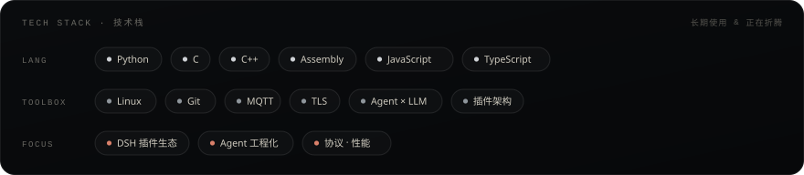
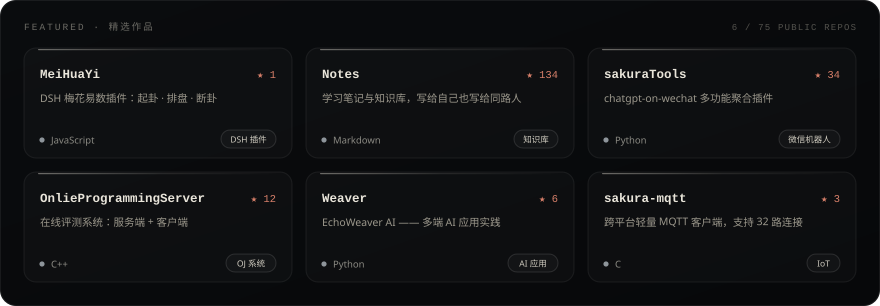
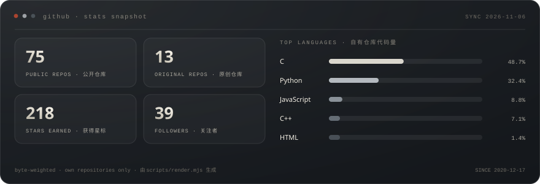

<!-- 本文件由 scripts/render.mjs 生成：文案/数据改好后重新运行 node scripts/render.mjs --fetch 即可 -->

  

<a href="#关于我">关于我</a> · <a href="#技术栈">技术栈</a> · <a href="#精选作品">精选作品</a> · <a href="#数据面板">数据面板</a> · <a href="#最近在忙">最近在忙</a> · <a href="#找到我">找到我</a>

01 · ABOUT

## 关于我

> 我是 **玄安**，坐标上海。**嵌入式工程师**，业余喜欢折腾**游戏开发**。  
> 从 C 指针一路折腾到 AI Agent —— 底层够硬，上层够野。

- 🔧 **嵌入式**　C / C++ / 汇编：MQTT 客户端、TLS 实战、协议细节与性能
- 🎮 **游戏开发**　业余做玩法原型与技术实验
- 🔭 **正在构建**　DSH 插件生态 —— [梅花易数 MeiHuaYi](https://github.com/Sakura7301/MeiHuaYi) 已上架
- 🧠 **长期折腾**　Multi-Agent / LLM 工程化，以及 `chatgpt-on-wechat` 生态
- ✍️ **学习笔记**　[Notes](https://github.com/Sakura7301/Notes) —— 134 ★ 的知识库

02 · STACK

## 技术栈

03 · SELECTED WORK

## 精选作品

全部 75 个仓库 → <a href="https://github.com/Sakura7301?tab=repositories">Repositories</a>

04 · STATS

## 数据面板

05 · NOW

## 最近在忙

- 把 DSH 插件做到真正「开箱即用」——梅花易数之后，还在憋下一个
- 啃 Agent 的工程化落地：记忆、工具调用、多智能体协作
- 偶尔回到底层，写点 C：MQTT、TLS、协议细节与性能
- 业余折腾游戏开发：玩法原型 + 引擎与工具链的小实验

06 · CONTACT

## 找到我

<a href="https://github.com/Sakura7301">GitHub</a> · <a href="https://github.com/Sakura7301/MeiHuaYi">MeiHuaYi</a> · <a href="https://github.com/Sakura7301/Notes">Notes</a> · <a href="https://github.com/Sakura7301/sakuraTools">sakuraTools</a> · <a href="https://github.com/Sakura7301/OnlieProgrammingServer">OnlieProgrammingServer</a>

  

如果这些项目帮到了你，欢迎点个 ⭐ —— 这是最直接的鼓励。

